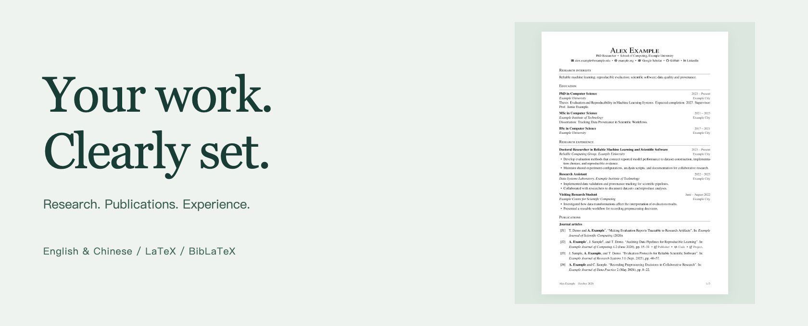

# Academic CV

A modular LaTeX CV for research and academia, with matched English and Simplified Chinese examples.

**[Download source ZIP ↓](https://github.com/DELONG-L/Academic-CV/releases/latest/download/academic-cv.zip)** · [User guide](docs/guide.md) · [简体中文](README.zh-CN.md)

<a href="dist/cv.pdf"></a>

[View English PDF ↗](dist/cv.pdf) · [View Chinese PDF ↗](dist/cv-zh.pdf)

Single column, serif type, ruled section headings, and right-aligned dates. Each supplied PDF contains three pages; click the cover to open the English example.

*The people, institutions, publications, and achievements in these examples are fictional.*

<p>
  <a href="https://github.com/DELONG-L/Academic-CV/actions/workflows/build.yml"></a>
  <a href="https://github.com/DELONG-L/Academic-CV/releases/latest"></a>
  <a href="LICENSE"></a>
</p>

## Inside the template

- **Two languages, considered separately.** Matched font families, CJK/Latin spacing, and independent English and Chinese content files.
- **Publications managed with BibLaTeX.** Author highlighting, J/C/P numbering, and links to publisher and preprint pages.
- **A structure that grows with your work.** Separate sections for education, research, teaching, funding, and service, with natural page breaks and PDF bookmarks.

## Get started

The quickest route is Overleaf. No Git or Python installation is needed.

1. [Download academic-cv.zip](https://github.com/DELONG-L/Academic-CV/releases/latest/download/academic-cv.zip). It includes editable sources, both examples, PDFs, documentation, and licences.
2. In Overleaf, choose **New Project → Upload Project** and upload the ZIP.
3. In project settings, select **TeX Live 2026** and the **XeLaTeX** compiler.
4. Set the main document to `main.tex` for English or `main-zh.tex` for Chinese, then replace the example content.

<details>
<summary><strong>Prefer a local build?</strong></summary>

Extract the same ZIP and open a terminal in the project folder. Use an updated **TeX Live 2026** installation, with LaTeX kernel 2026-06-01 or newer, XeLaTeX, Biber, latexmk, and Chinese language support.

```bash
latexmk -xelatex main.tex
latexmk -xelatex main-zh.tex
```

See the [local installation and build guide](docs/guide.md#quick-start) for setup, Git cloning, and platform-specific instructions.

</details>

<details>
<summary><strong>Need additional Chinese PDF viewer compatibility?</strong></summary>

The optional Python build embeds standard CJK Unicode maps so PDF viewers can display, search, and copy Chinese without loading external maps. With Python 3.10 or newer, follow the [Python build instructions](docs/guide.md#quick-start); the outputs are `dist/cv.pdf` and `dist/cv-zh.pdf`.

</details>

## Make it yours

| What to change | Where to edit |
|---|---|
| Name and contact details | English: [config/profile.tex](config/profile.tex)<br>Chinese: [config/profile-zh.tex](config/profile-zh.tex) |
| Experiences and achievements | English: [content/](content/)<br>Chinese: [content/zh/](content/zh/) |
| Section order | English: [content/sections.tex](content/sections.tex)<br>Chinese: [content/zh/sections.tex](content/zh/sections.tex) |
| Publications | English: [data/publications.bib](data/publications.bib)<br>Chinese: [data/publications-zh.bib](data/publications-zh.bib) |
| Fonts, spacing, margins, and icons | Shared: [config/style.tex](config/style.tex) |

The class is `academic-cv.cls`, loaded with `\documentclass{academic-cv}`. The [user guide](docs/guide.md) covers entry layout, Chinese typography, publication fields, author highlighting, and checks and packaging.

## Attribution and licence

MIT licensed. The modular structure and bibliography approach are inspired by [Simple-CV](https://github.com/dcetin/Simple-CV). Academic section coverage draws on [Academic CV by Diego](https://github.com/damascenodiego/Academic-CV-by-Diego) and [academistral-cv](https://github.com/beyefendi/academistral-cv), without copying their source code. See [NOTICE.md](NOTICE.md) and [licenses/](licenses/) for attribution and third-party licence notices.
