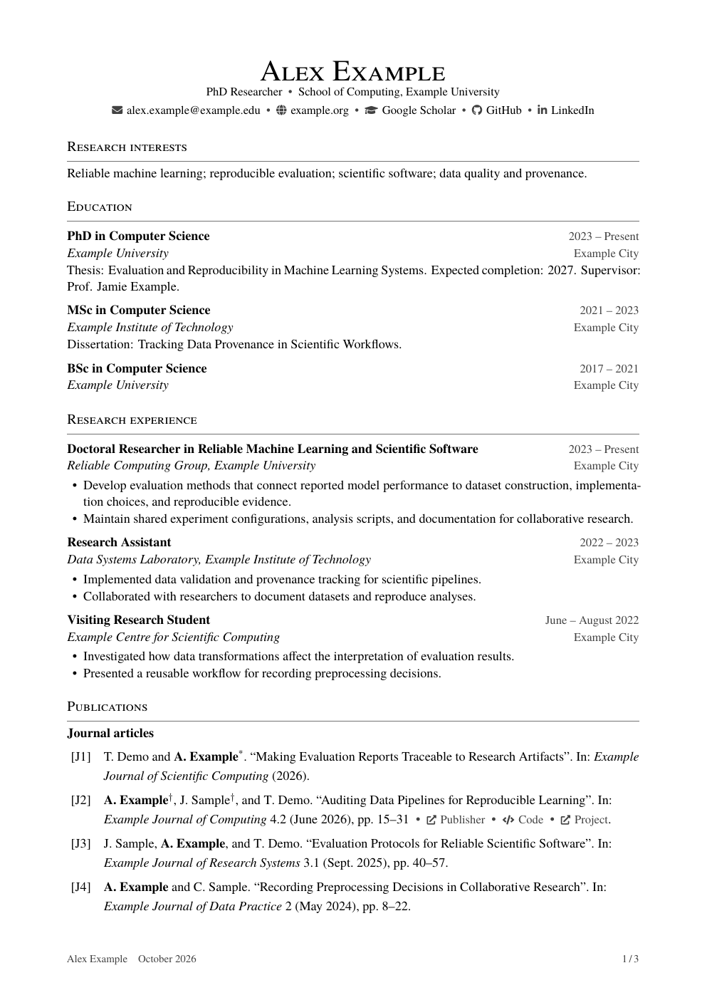
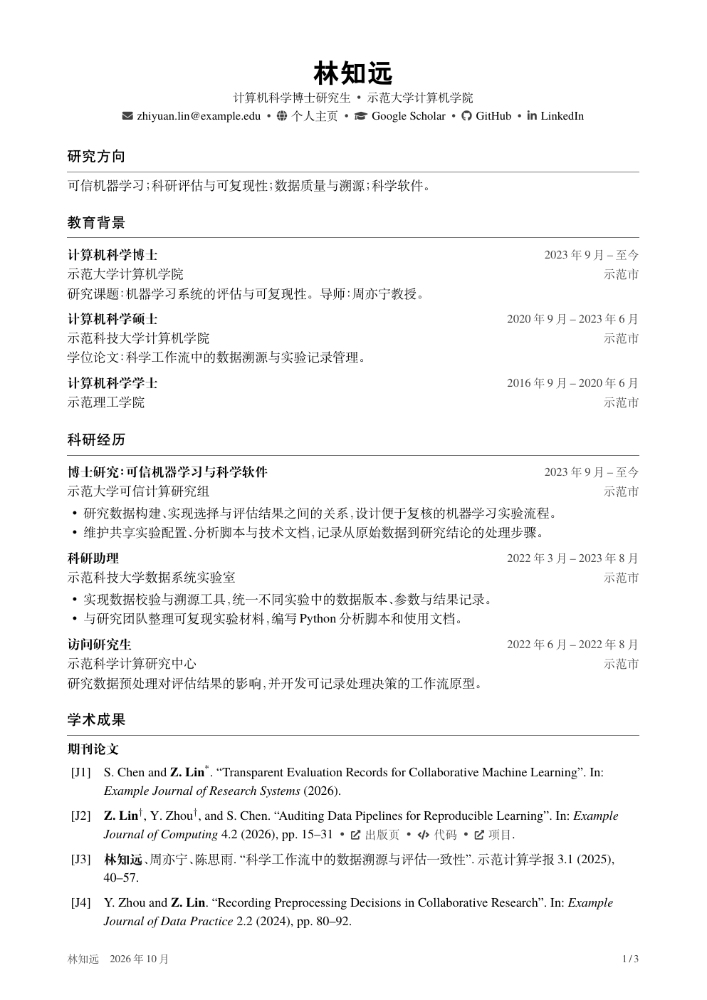

# Academic CV

一个适合长期维护的 LaTeX 学术 CV 模板。采用单栏、衬线字体、居中姓名、横线分节和右侧日期，支持论文管理与多页排版。

模板类文件为 `academic-cv.cls`，使用 `\documentclass{academic-cv}` 加载。

[下载 TeX 源码 ZIP](https://github.com/DELONG-L/Academic-CV/releases/latest/download/academic-cv.zip) · [English](README.md) · [英文示例](dist/cv.pdf) · [中文示例](dist/cv-zh.pdf)

示例中的人物、机构、论文和经历均为虚构，用于展示格式。它们不是项目所有者的个人资料。

## 预览

以下为第一页预览；点击图片可打开完整的三页 PDF。

<table>
  <tr><th>英文</th><th>简体中文</th></tr>
  <tr>
    <td><a href="dist/cv.pdf"></a></td>
    <td><a href="dist/cv-zh.pdf"></a></td>
  </tr>
</table>

## 功能

- **专门的中文排版。** 提供简体中文示例、宋体正文、黑体标题、中文行距和作者姓名格式；同一类文件支持中英混排。
- **按栏目维护内容。** 教育、科研、教学、指导、服务、资助、报告、奖励和软件各有独立文件；排序和启用状态由一个文件控制。
- **从 BibLaTeX 生成论文列表。** 期刊、会议论文和预印本分别使用 J、C、P 前缀编号，各组按年份倒序排列。已接收论文归入相应的期刊或会议列表。
- **突出本人姓名。** 按姓名配置自动加粗；姓名变体也可通过 BibLaTeX 的姓名注解明确标记。
- **适合多页。** 按标题实际高度安排分页，较长的标题可以自动改为上下排列；空栏目自动省略。
- **简洁图标。** 联系方式和论文资源链接使用小型单色图标，保留文字标签，可一键关闭；缺少图标包时使用纯文字。
- **PDF 导航。** 栏目与论文分组带书签，文档语言可配置，页脚显示姓名、更新月份和总页数。
- **可调整的简洁样式。** 默认黑白、A4、11 pt；支持中英混排，使用 TeX Live 自带字体，无需下载商业字体。
- **本地与 Overleaf。** 提供一键构建、资料检查、PDF 检查、独立功能示例、打包脚本和 GitHub Actions 配置。

## 快速开始

下载准备好的 [TeX 源码 ZIP](https://github.com/DELONG-L/Academic-CV/releases/latest/download/academic-cv.zip)。压缩包包含可编辑的 TeX 和论文资料、中英文示例、示例 PDF、使用说明和许可证。可以直接上传到 Overleaf，也可以解压后在本地修改和编译，无需安装 Git。

需要 Python 3.10 或更新版本，以及更新后的 **TeX Live 2026**（LaTeX 内核为 2026-06-01 或更新版本）。模板使用 XeLaTeX、Biber、latexmk 和中文支持。请按照 [TeX Live 官方安装指南](https://tug.org/texlive/quickinstall.html) 安装当前版本；macOS 也可安装 MacTeX。安装后使用 `tlmgr update --self --all` 更新组件。完整发行版包含所需字体和宏包；精简安装可参考 `texlive-packages.txt`。Ubuntu 24.04 默认提供的旧版 TeX Live 不在支持范围内。GitHub Actions 同样使用 TeX Live 2026。

macOS 会自动查找 `/Library/TeX/texbin`。其他系统可将这些工具加入 PATH，或设置 `TEXLIVE_BIN`。也可以通过 Git 克隆项目：

```bash
git clone https://github.com/DELONG-L/Academic-CV.git
cd Academic-CV
```

在解压或克隆后的项目文件夹中打开终端，使用独立的 Python 环境构建：

```bash
python3 -m venv .venv
source .venv/bin/activate
python3 -m pip install -r requirements-build.txt
python3 scripts/build.py
```

Windows 下改用 `.venv\Scripts\activate` 激活环境。

默认构建英文和简体中文各一份 CV，分别为 `dist/cv.pdf` 和 `dist/cv-zh.pdf`。构建缓存放在 `_build/`，也可通过 `ACADEMIC_CV_BUILD_DIR` 指定独立缓存目录。

构建脚本还会把中文字体的 Unicode 字符映射写入 PDF，使显示、搜索和复制中文不依赖阅读器额外加载 Adobe CMap。字体、字号、页面内容和分页保持原样。这个步骤使用 `pypdf`，不把文字转成图片。

同一次请求的所有语言文档都成功后，脚本才更新交付文件。`dist/build-manifest.json` 保存源码指纹、PDF 校验值和实际布局参数，供检查与打包使用，不写入 CV 正文。编译失败时保留上一次的交付文件；检查或打包会识别它们与当前源码是否一致。

```bash
python3 scripts/build.py --language en
python3 scripts/build.py --language zh
python3 scripts/build.py --clean
```

也可以直接使用 TeX 工具，无需 Python：

```bash
latexmk -xelatex main.tex
latexmk -xelatex cv-zh.tex
```

直接运行 TeX 或在 Overleaf 编译不会执行 Python 的字符映射补全步骤。如果成品在某个内置预览中缺少中文，而 macOS“预览”等阅读器正常，请使用 `scripts/build.py` 生成兼容版 PDF。

## Overleaf

1. 下载 [academic-cv.zip](https://github.com/DELONG-L/Academic-CV/releases/latest/download/academic-cv.zip)。也可使用 GitHub 的 **Code → Download ZIP** 获取最新仓库源码。
2. 在 Overleaf 中选择 **New Project → Upload Project**，上传 ZIP。
3. 在项目设置中选择 **TeX Live 2026**，并将编译器设为 **XeLaTeX**。
4. 按下表选择主文件。

| 语言 | 主文件 |
|---|---|
| 英文 | `main.tex` |
| 中文 | `cv-zh.tex` |

Overleaf 支持项目使用的标准 BibLaTeX/Biber 工作流。

## 填写资料

| 文件 | 维护内容 |
|---|---|
| `config/profile.tex` | 姓名、职位、单位、联系方式、更新月份、用于加粗的作者姓名 |
| `config/style.tex` | 字体、颜色、页边距和日期列宽 |
| `content/sections.tex` | 栏目顺序与启用状态 |
| `content/*.tex` | 教育、科研、教学、服务等具体条目 |
| `data/publications.bib` | 论文元数据与状态分组 |
| `config/profile-zh.tex` | 中文资料与 `language={zh-CN}` |
| `content/zh/*.tex` | 中文各栏目内容与栏目顺序 |
| `data/publications-zh.bib` | 中文示例使用的中英文论文资料 |

职位与单位在姓名下方合为一行，以圆点分隔。姓名、职位与单位、联系方式各行采用一致的间距。任一职位或单位字段留空时省略分隔符；较长的内容会自然换行。

联系方式可以全部留空，模板会省略对应项目及分隔符。邮箱和网址支持直接填写 `_`；源文件中的 `%`、`&`、`#` 可分别写为 `\%`、`\&`、`\#`。其他普通文字字段仍遵循 LaTeX 的转义规则。

网站、GitHub 和 LinkedIn 均显示在姓名下方的联系方式栏，可分别设置短的显示文字与完整目标 URL。未填写网站标签时，模板显示域名；链接仍指向完整网址。GitHub 的默认标签会省略协议并允许断行；LinkedIn 的默认标签为 `LinkedIn`。`scholar` 和 `scholar-label` 用于 Google Scholar 等学术资料页。

在对应的 `config/profile.tex` 或 `config/profile-zh.tex` 中填写社交资料链接：

```latex
\CVSetup{
  github={https://example.org/your-profile/github},
  github-label={GitHub},
  linkedin={https://example.org/your-profile/linkedin},
  linkedin-label={LinkedIn}
}
```

示例链接使用保留域名 `example.org`，使用时替换为自己的资料页。只保留一个平台时，将另一个 URL 留空；对应图标、文字和分隔符会自动省略。

ORCID 输入真实的完整标识符；没有时留空即可。构建会检查其格式与校验位，不推断它属于谁。`language={en-GB}` 或 `language={zh-CN}` 设置 PDF 文档语言；中文还会启用相应的排版与资源标签。栏目文字由内容文件控制。长姓名可使用 `footer-name` 设置较短的页脚显示文字。

## 中文与中英混排

中文示例使用 TeX Live 自带的 Fandol 字体：正文为宋体，姓名为粗黑体，栏目标题为常规黑体，条目标题与论文分组为粗宋体；中文机构名称使用正体。正文保持 11 pt，栏目标题为 12 pt，姓名为 22 pt；中文默认行距倍率为 `1.15`。姓名与栏目中的英文使用 TeX Gyre Heros，正文与条目中的英文使用 TeX Gyre Termes，分别与黑体和宋体配合。无需依赖 macOS 或 Windows 的系统字体。

中文与英文、数字之间默认保留 `0.20em` 间隔。模板统一处理自动间隔和源文件中的手动空格，因此 `使用Python` 与 `使用 Python` 的排版一致，加粗英文也遵循这条规则。中文标点采用紧凑间距，句末点号保留完整宽度；行边界不悬挂标点，避免文字伸出页边距。英文论文中的原始标点与斜体保持原样。

设置 `language={zh-CN}` 会启用中文排版、中文 PDF 标题、作者角色说明，以及“出版页 / 预印本 / 代码 / 项目”资源标签。模板不会自动翻译姓名、经历、栏目或论文。中文内容在 `content/zh/` 中独立维护；论文保留发表时的原始标题和作者拼写。

行距和中文字体可以按需要调整：

```latex
\CVStyle{line-spread=1.15,cjk-latin-gap=.20em,cjk-entry-family=serif}
% 想让条目标题也使用黑体，可设置 cjk-entry-family=sans。
% 如需替换字体，先确认对应字体已安装且有粗体字重：
% \CVStyle{cjk-font={Your CJK Serif Family},
%          cjk-sans-font={Your CJK Sans Family}}
```

字体替换后需要重新检查粗体、姓名、标点和分页。默认示例与测试针对简体中文；繁体中文或生僻字应选用覆盖所需字符的字体并检查成品。PDF 文档语言不会执行简繁转换。

中文作者用“姓, 名”存储，并用 `cjk` 注解保留完整姓名、按姓在前排列。`cjk` 与 `highlight`、`cofirst`、`corresponding` 可同时使用：

```bibtex
author    = {林, 知远 and 周, 亦宁},
author+an = {1=cjk,highlight,cofirst; 2=cjk,cofirst},
```

输出为“林知远†、周亦宁†”；角色标记放在完整姓名之后。英文署名仍遵循英文缩写规则。`author-names=full` 可显示英文完整名字；`max-authors` 同样适用于中文作者，被截断的中文名单以“等”结尾。

中文论文还可在 `keywords` 中添加 `chinese`，让刊名和会议名使用正体，并省略英文的 `In:` 与页码前缀；它不改变论文的状态分组。英文论文保留原来的格式。这里采用 CV 的 BibLaTeX numeric 书目样式，不宣称符合 GB/T 7714。

## 图标与排版

在 `config/style.tex` 中设置：

```latex
\CVStyle{
  icons=minimal,
  density=compact,
  entry-layout=auto
}
```

| 选项 | 可选值与作用 |
|---|---|
| `icons` | `minimal` 在联系方式和资源链接旁显示小图标；`none` 使用纯文字 |
| `density` | `classic` 保留默认间距；`compact` 缩小间距，保持 11 pt 字号 |
| `entry-layout` | `auto` 在标题过高时改为上下排列；`columns` 固定两列；`stacked` 固定上下排列 |
| `stack-threshold` | 自动切换布局的高度，默认 `3.5\baselineskip` |
| `date-width` | 日期列宽，默认 `33mm` |
| `max-authors` | 论文中最多显示的作者数，默认 `99` |
| `author-names` | `initials` 使用名字首字母；`full` 使用完整名字 |
| `line-spread` | 自定义行距倍率；英文默认 `1`，中文默认 `1.15` |
| `cjk-entry-family` | 中文条目和论文分组使用 `serif`（默认粗宋体）或 `sans`（粗黑体） |
| `cjk-latin-gap` | 中文与英文、数字的间隔；默认 `.20em`，可设为非负长度 |
| `cjk-font` / `cjk-sans-font` | 替换中文正文或标题字体；字体必须在编译环境中可用 |

所有示例都采用 `compact`，保持 11 pt 字号；需要更宽松的间距时可改用 `classic`。图标统一使用 TeX Live 中可选的 `fontawesome5`，学术主页使用通用学术图标。图标始终配有文字；缺少图标包时使用纯文字。`accsupp` 可用时，为装饰图标设置空的复制文本。书签与语言信息不等同于完整的 PDF/UA 无障碍认证。

栏目横线为 0.3 pt，颜色随 `accent` 淡化。两种密度都区分栏目间、条目间和条目内部的留白；论文分组标题贴近首条文献，分组之间留出更大的间距。资源链接使用 10 pt 深灰文字和较小图标，与 11 pt 的文献信息区分。

日期、地点和简短角色说明统一使用 10 pt 深灰正体；中英文以及两列、上下排列都采用相同样式。机构名称和正文保持各自的字号与样式。

联系方式和文献列表保留至少 `1.45em` 的基线间距，防止换行后不同链接的点击区域重叠；更大的自定义行距会保留。正文的 `line-spread` 设置不受这一最小间距影响。

## 条目与栏目

```latex
\CVEntry{Research Assistant}{2024 -- 2026}
  {University / Research Group}{Sydney, Australia}{
  \begin{cvitems}
    \item Describe a concrete contribution.
    \item Include an outcome when it is supported by evidence.
  \end{cvitems}
}
```

五个字段依次为：条目标题、日期、职位或机构说明、地点或其他短信息、正文。

简短条目可以使用 `\CVLine{标题}{日期}{补充说明}`；普通段落使用 `\CVParagraph{正文}`。所有条目都进入对应语言的 CV。

在 `content/sections.tex` 或 `content/zh/sections.tex` 中移动一行即可调整栏目顺序，注释一行即可停用该栏目。使用 `\CVIncludeSection{栏目标题}{文件路径}` 读取栏目文件。栏目内容使用上述条目或段落命令时，空栏目标题会自动省略。

中英文示例均采用自然分页，让学术成果衔接前面的内容。需要让某个栏目从新页开始时，可使用 `\CVIncludeSection*{栏目标题}{文件路径}`；分页只在栏目实际输出内容时发生，空栏目不会留下分页。模板保持自然页底留白，不拉伸段落来填满页面。

页数随内容自然变化。需要缩短时，在相应栏目文件中删减条目或调整正文。

## 论文管理

每篇论文在 `keywords` 中设置一个分组类别：

```bibtex
@article{paper-key,
  author       = {Family, Given and Collaborator, Given},
  title        = {Paper Title},
  journaltitle = {Journal Name},
  date         = {2026},
  keywords     = {journal}
}
```

| 分组类别 | 默认分组 | 含义 |
|---|---|---|
| `journal` | Journal articles / J | 已发表或已接收的期刊论文 |
| `conference` | Conference papers / C | 已发表或已接收的会议论文 |
| `preprint` | Preprints / P | 选择展示的预印本 |
| `underreview` | 默认停用 / R | 在审稿件；按需要单独启用 |

已接收论文和已发表论文使用同一套 J 或 C 编号，不单设已接收分组，也不显示“待刊 / In press”标记。已接收但尚未正式发表时，在源数据中保留 `pubstate={inpress}` 或 `pubstate={forthcoming}`，用于选择公开预印本链接：

```bibtex
keywords = {journal}, % 会议论文使用 conference
pubstate = {inpress},
```

预印本由你根据研究贡献、相关性和影响力选择收录；在资料文件中保留需要展示的条目。分类和发表状态均由你显式填写，模板不会从年份、文献类型或链接是否缺失推断接收状态。缺少分组类别或同时填写多个分组类别时，编译会报出对应记录的 key。`underreview` 默认停用，启用方式在 `content/publications.tex` 中给出。空的论文分组自动省略。

编号在各组内分别生成。跨文档追踪请使用稳定的 BibTeX key 或 DOI。

`\CVAuthorName{Given}{Family}` 按 `.bib` 中完整的名和姓匹配。若某篇论文使用不同拼写或只写首字母，可以直接标记对应作者的位置：

```bibtex
author    = {Family, G. and Collaborator, Given},
author+an = {1=highlight},
```

`1` 表示第一位作者。模板不会根据同姓或作者顺序猜测本人身份。

共同一作和通讯作者也通过明确的作者位置设置：

```bibtex
author+an = {1=highlight,cofirst; 2=cofirst; 3=corresponding},
```

`cofirst` 显示 †，`corresponding` 显示 *。`content/publications.tex` 中的 `\CVAuthorLegend` 只解释当前版本实际出现的标记。这些角色必须根据论文事实填写。作者截断可能省略本人，选择 `max-authors` 时应检查最终列表。

每篇论文最多显示一个主链接。正式发表的 `journal` 和 `conference` 条目显示“出版页 / Publisher”，优先使用 DOI，其次使用出版社官方页面的 `url`。正式发表后移除 `inpress` 或 `forthcoming` 状态。例如：

```bibtex
keywords = {journal},
doi   = {REAL_DOI},
url   = {https://publisher.example/articles/your-paper},
userb = {https://your-site.example/code},
userc = {https://your-site.example/project},
```

设置 `pubstate={inpress}` 或 `pubstate={forthcoming}` 的期刊、会议论文，以及 `preprint` 和 `underreview` 条目，优先链接公开的 arXiv 摘要页：

```bibtex
keywords  = {preprint},
eprinttype = {arxiv},
eprint    = {REAL_ARXIV_ID},
```

填写真实的裸 DOI 或 arXiv 编号。其他预印本平台可填写 `url`，显示“预印本 / Preprint”。不要填写 PDF 下载地址。已发表条目优先使用 DOI；未发表条目优先使用 `eprinttype={arxiv}` 的 `eprint`。其次使用 `url`，最后兼容旧字段 `usera`。多个字段同时存在时只显示一个主链接；没有公开链接时省略。DOI、URL 和预印本编号保留在资料中，默认不再重复显示完整标识符或长网址。示例论文使用 `example.org` 占位页面，不指向真实出版社或论文。

`userb` 和 `userc` 分别显示为“代码 / Code”和“项目 / Project”。文献采用左对齐，让长标题和资源链接自然换行。每个链接的图标和文字一起换行；分隔点在换行处自动省略，留空的字段不产生多余分隔点。

`academic-cv.dbx` 将这三个字段声明为网址，需与 `academic-cv.cls` 一起保留。在 `.bib` 的这些字段中直接填写完整 URL，包括 `_`、`&`、`#` 和 `%20` 等编码，无需添加 LaTeX 转义。例如：

```bibtex
userb = {https://your-site.example/code?file=src_main.py&tag=cv%20test#usage},
```

这一规则适用于 `.bib` 中的网址字段；`config/profile.tex` 中的联系方式仍按前文的 LaTeX 转义规则填写。

## 检查与打包

默认压缩包为 `dist/academic-cv.zip`。

构建先用 Biber 解析论文资料，检查必要字段、日期、重复 DOI 和资源链接格式；分类状态仍由你显式填写。字段检查不代表 DOI 或网址已通过在线真实性或可达性验证。

编译脚本会拒绝最终日志中的文字溢出、缺字、未解决的引用和 Biber 警告。PDF 的视觉检查仍然需要打开成品，或使用 Poppler 将每页渲染为图片。

额外的自动检查需要安装可选依赖：

```bash
python3 -m pip install -r requirements-qa.txt
python3 scripts/check.py
python3 scripts/smoke.py
```

`check.py` 根据编译时的实际页边距检查文字边界、页码、空页、栏目标题与正文，并核对实际配置的联系方式和资源链接、书签及文档语言。它还检查链接点击区域是否越界或与不同目标的链接重叠，要求标准 CJK 字体自带 Unicode 字符映射，并用第二个 PDF 解析器核对中文文字。需要先使用构建脚本生成清单；仅检查某一种语言时可加 `--language en` 或 `--language zh`。

`smoke.py` 使用独立示例检查长标题、特殊字符邮箱、长网址、中英混排、空栏目省略、图标关闭与缺包回退、作者标记，以及构建失败后保留旧文件和拒绝打包旧 PDF 的行为。它还检查中文长标题、完整中文作者姓名、中文标点换行、作者截断、手动空格与自动间隔的一致性，标题和日期的基线对齐，以及长栏目标题与首条内容的分页。资源链接示例覆盖三个字段的全部八种组合、发表状态与 DOI / arXiv / URL 的选取、窄行换行、分隔点间距、图标回退和带查询参数的长网址，并确认 PDF 检查会拒绝点击区域重叠或越界的链接。它会在缓存目录创建测试项目副本，不改写个人资料。

也可以单独检查论文资料：

```bash
python3 scripts/lint.py
```

要检查本项目附带的虚构示例，还可以运行 `python3 scripts/check.py --sample`。填入个人资料后，使用普通检查即可。

```bash
python3 scripts/pack.py
```

打包要求中英文示例都对应当前源码，且 PDF 校验值未变化。只重建一种语言后，若另一种语言已过期，应先重建全部版本再打包。ZIP 包含可编辑源码、文档、示例 PDF、构建清单和许可证，不包含编译缓存。GitHub Actions 自动构建、检查和打包示例；推送以 `v` 开头的版本标签时，将源码 ZIP 和两份示例 PDF 发布到 GitHub Release。

## 项目来源与许可

本项目借鉴 [Simple-CV](https://github.com/dcetin/Simple-CV) 的模块化和论文管理思路。学术栏目参考 [Academic CV by Diego](https://github.com/damascenodiego/Academic-CV-by-Diego) 与 [academistral-cv](https://github.com/beyefendi/academistral-cv)；未复制这两个项目的源码。

项目采用 MIT 许可。原始 MIT 声明保存在 `licenses/`，具体来源与实现边界见 [NOTICE.md](NOTICE.md)。
