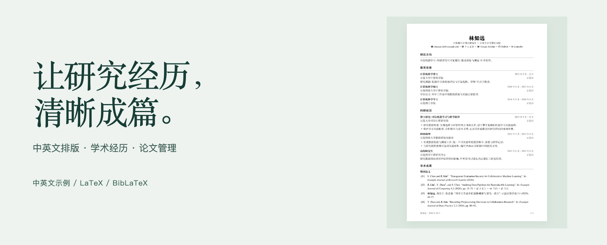

# Academic CV

模块化的 LaTeX 学术简历模板，提供排版风格一致、内容独立维护的中英文示例。

**[下载源码 ZIP ↓](https://github.com/DELONG-L/Academic-CV/releases/latest/download/academic-cv.zip)** · [使用指南](docs/guide.zh-CN.md) · [English](README.md)

<a href="dist/cv-zh.pdf"></a>

[查看中文 PDF ↗](dist/cv-zh.pdf) · [查看英文 PDF ↗](dist/cv.pdf)

单栏布局、衬线字体、横线分节与日期右对齐。两份示例 PDF 均为三页；点击封面可打开中文示例。

*示例中的人物、机构、论文与经历均为虚构，用于展示格式。*

<p>
  <a href="https://github.com/DELONG-L/Academic-CV/actions/workflows/build.yml"></a>
  <a href="https://github.com/DELONG-L/Academic-CV/releases/latest"></a>
  <a href="LICENSE"></a>
</p>

## 模板包含什么

- **中英文，分别处理细节。** 配套字体与中英混排间隔，两个语言版本独立维护内容。
- **论文列表，交给 BibLaTeX。** 本人姓名加粗、J/C/P 编号，以及出版页和预印本链接。
- **经历增长，结构依然清楚。** 教育、科研、教学、资助与服务分别维护，支持自然分页和 PDF 书签。

## 开始使用

最直接的方式是 Overleaf，无需安装 Git 或 Python。

1. [下载 academic-cv.zip](https://github.com/DELONG-L/Academic-CV/releases/latest/download/academic-cv.zip)，其中包含可编辑源码、中英文示例、PDF、说明和许可证。
2. 在 Overleaf 中选择 **New Project → Upload Project**，上传 ZIP。
3. 在项目设置中选择 **TeX Live 2026** 和 **XeLaTeX** 编译器。
4. 英文主文件选择 `main.tex`，中文选择 `main-zh.tex`，然后把示例替换为自己的资料。

<details>
<summary><strong>想在本地构建？</strong></summary>

解压同一个 ZIP，在项目文件夹中打开终端。需要更新后的 **TeX Live 2026**，包含 2026-06-01 或更新的 LaTeX 内核、XeLaTeX、Biber、latexmk 和中文支持。

```bash
latexmk -xelatex main.tex
latexmk -xelatex main-zh.tex
```

安装、Git 克隆与不同系统的设置方法见[本地构建指南](docs/guide.zh-CN.md#快速开始)。

</details>

<details>
<summary><strong>需要改善中文 PDF 的阅读器兼容性？</strong></summary>

可选的 Python 构建会补全中文字体的标准 Unicode 字符映射，使显示、搜索和复制中文不依赖阅读器额外加载字符映射。使用 Python 3.10 或更新版本，按[构建指南](docs/guide.zh-CN.md#快速开始)操作；输出为 `dist/cv.pdf` 和 `dist/cv-zh.pdf`。

</details>

## 换成自己的资料

| 修改内容 | 对应文件 |
|---|---|
| 姓名与联系方式 | 英文：[config/profile.tex](config/profile.tex)<br>中文：[config/profile-zh.tex](config/profile-zh.tex) |
| 经历与成果 | 英文：[content/](content/)<br>中文：[content/zh/](content/zh/) |
| 栏目顺序 | 英文：[content/sections.tex](content/sections.tex)<br>中文：[content/zh/sections.tex](content/zh/sections.tex) |
| 论文资料 | 英文：[data/publications.bib](data/publications.bib)<br>中文：[data/publications-zh.bib](data/publications-zh.bib) |
| 字体、间距、页边距与图标 | 两个示例共用：[config/style.tex](config/style.tex) |

类文件为 `academic-cv.cls`，通过 `\documentclass{academic-cv}` 加载。[使用指南](docs/guide.zh-CN.md)说明条目布局、中文排版、论文字段、作者姓名加粗，以及检查和打包方法。

## 项目来源与许可

项目采用 MIT 许可。模块化和论文管理思路借鉴 [Simple-CV](https://github.com/dcetin/Simple-CV)。学术栏目参考 [Academic CV by Diego](https://github.com/damascenodiego/Academic-CV-by-Diego) 与 [academistral-cv](https://github.com/beyefendi/academistral-cv)，未复制这两个项目的源码。来源与第三方许可声明见 [NOTICE.md](NOTICE.md) 和 [licenses/](licenses/)。
